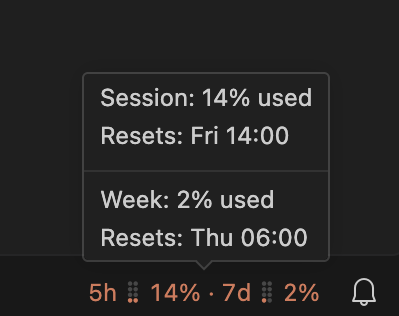

# VSCode Claude Usage Status Bar

Shows your Claude plan usage in the VS Code status bar: the 5-hour session and the 7-day week. Hover for the percentages and reset times.



The bars update after each Claude Code reply, in the VS Code chat panel and in the terminal.

## Requirements

- macOS
- A Claude Pro, Max or Ultra plan
- [Claude Code](https://code.claude.com) 2.1.318 or later
- VS Code, with the `code` command in your `PATH` (in VS Code, run **Shell Command: Install 'code' command in PATH**)
- Node.js 18 or later

## Install

```bash
./install.sh
```

Then:

1. In each VS Code window, run **Developer: Reload Window**.
2. Start a new Claude chat. The bars show after its first reply.

## Uninstall

```bash
./uninstall.sh
```

Then reload each VS Code window.

## Change the color

Add this to your VS Code `settings.json`:

```json
"workbench.colorCustomizations": {
  "claudeUsageStatusbar.foreground": "#D97757"
}
```
